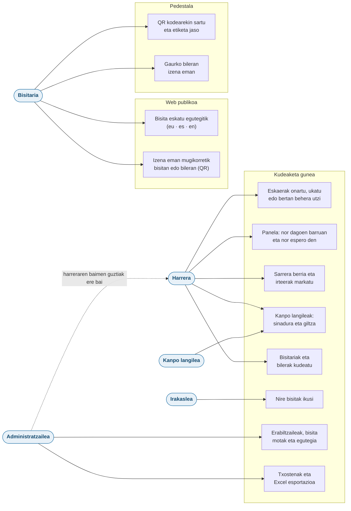
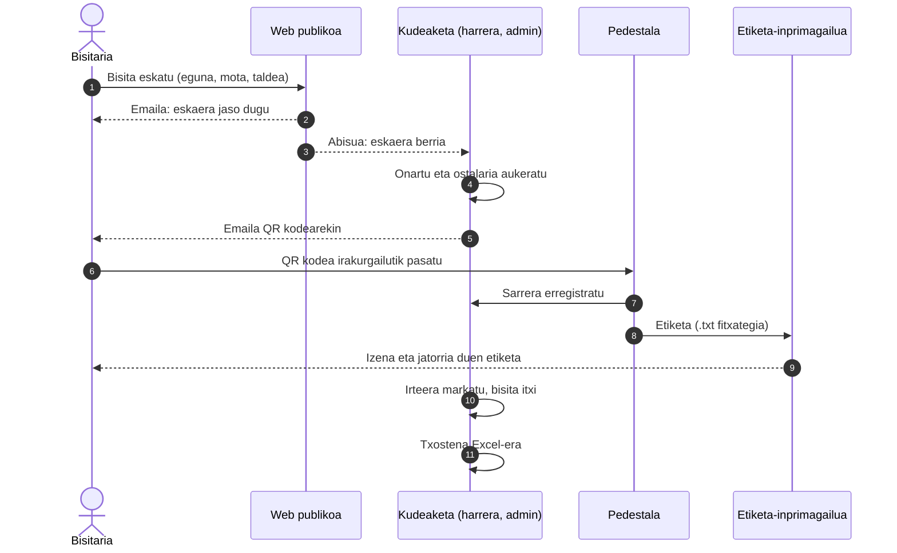
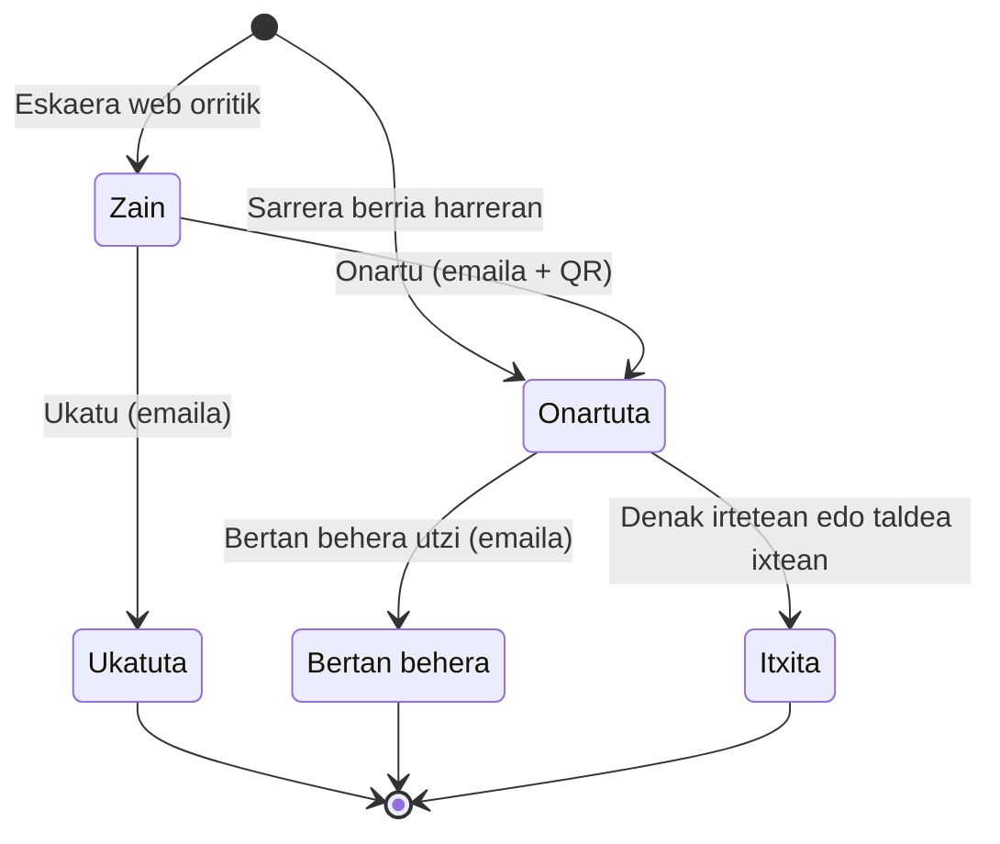
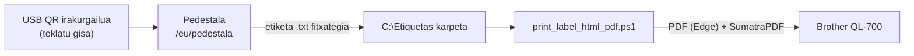

# MAltuna Bisitak

Miguel Altuna ikastetxeko bisiten kudeaketa. Bisitariek web orritik eskatzen dute bisita (euskaraz, gaztelaniaz edo ingelesez), harrerak onartzen du, eta bisitariak pedestalean sartzen dira QR kodearekin; etiketa bere kabuz inprimatzen da. Harrerak une oro daki nor dagoen ikastetxean, eta hilabeteko txostenak Excel-era ateratzen dira.


> Laravel aplikazioa [`MaltunaBisitak/`](MaltunaBisitak) karpetan dago.

## Edukia

- [Erabilera kasuak](#erabilera-kasuak)
- [Bisita baten bidaia](#bisita-baten-bidaia)
- [Bisiten egoerak](#bisiten-egoerak)
- [Rolak eta baimenak](#rolak-eta-baimenak)
- [Helbide nagusiak](#helbide-nagusiak)
- [Beharrezkoak](#beharrezkoak)
- [Instalazioa (garapena)](#instalazioa-garapena)
- [Produkzioan jartzea](#produkzioan-jartzea)
- [Pedestala](#pedestala)
- [Testak](#testak)
- [Proiektuaren egitura](#proiektuaren-egitura)

## Erabilera kasuak

Nork zer egin dezakeen, hiru gunetan banatuta: web publikoa, pedestala eta kudeaketa gunea.



## Bisita baten bidaia

Talde baten bisita, eskaeratik txostenera. Emailak eskatzailearen hizkuntzan bidaltzen dira.



Taldekideek ere eman dezakete izena mugikorretik, bisitaren QR kodea eskaneatuta. Bakoitzak bere QR kodea jasotzen du, pedestalean sartzeko.

## Bisiten egoerak



## Rolak eta baimenak

| Atala | Admin | Harrera | Irakaslea |
| --- | :---: | :---: | :---: |
| Panela | ✅ | ✅ | ✅ (zure bisitak) |
| Bisitak: onartu, ukatu, bertan behera utzi | ✅ | ✅ | — |
| Sarrera berria, sarrerak eta irteerak | ✅ | ✅ | — |
| Bisitariak | ✅ (ezabatu barne) | ✅ | — |
| Bilerak | ✅ | ✅ | — |
| Kanpo langileak | ✅ | ✅ | — |
| Txostenak eta Excel esportazioa | ✅ | — | — |
| Egutegia | ✅ | — | — |
| Bisita motak | ✅ | — | — |
| Erabiltzaileak | ✅ | — | — |

Web publikoa eta mugikorreko izen-ematea edonork erabil ditzake, saiorik gabe. Pedestalak ez du saiorik behar, baina kudeaketa gunea bezala, ikastetxeko saretik bakarrik ireki daiteke.

## Helbide nagusiak

| Helbidea | Zertarako | Sarbidea |
| --- | --- | --- |
| `/eu` · `/es` · `/en` | Bisita eskatu | Edonork |
| `/eu/bisita/{uuid}` · `/eu/bilera/{uuid}` | Mugikorretik izena eman (QR bidez) | Estekarekin, edonork |
| `/eu/pedestala` | Pedestala (QR irakurgailua, bilerak, taldeak) | Ikastetxeko saretik |
| `/login` → `/panela` | Kudeaketa gunea | Langileak, ikastetxeko saretik |
| `/txostenak` | Txostenak eta Excel esportazioa | Admin |

## Beharrezkoak

| Osagaia | Bertsioa |
| --- | --- |
| PHP | 8.4 edo berriagoa |
| PHP luzapenak | `intl` (herrialdeen izenak), `gd` (QR kodeak), `zip` eta `xml` (Excel), `mbstring`, `pdo_sqlite` edo `pdo_mysql`, eta Laravel-ek eskatzen dituen ohikoak |
| Composer | 2.x |
| Node.js | 20.19+ edo 22.12+ (npm-ekin) |
| Datu-basea | SQLite (garapena) edo MySQL / MariaDB (produkzioa) |

## Instalazioa (garapena)

```bash
git clone https://github.com/aeluet/MaltunaBBisitak.git
cd MaltunaBBisitak/MaltunaBisitak
composer run setup
php artisan db:seed
composer run dev
```

1. `composer run setup` paketeak instalatzen ditu, `.env` sortzen du `.env.example`-tik, aplikazioaren gakoa sortzen du, migrazioak exekutatzen ditu (SQLite) eta CSS eta JavaScript-a eraikitzen ditu.
2. `php artisan db:seed` 10 bisita motak kargatzen ditu, eta `APP_ENV=local` denean, demo-datuak ere bai.
3. `composer run dev` garapen-zerbitzaria eta Vite abiarazten ditu: <http://localhost:8000>.

Demo-kontuak (lokalean bakarrik): `admin@example.com` eta `harrera@example.com`, pasahitza `password`.

<details>
<summary>Pausoak banan-banan</summary>

```bash
composer install
cp .env.example .env
php artisan key:generate
php artisan migrate --seed
npm install
npm run build
php artisan serve
```

</details>

Aholkuak garapenerako:

- Emailak fitxategi batean ikusteko, jarri `MAIL_MAILER=log` `.env`-n: `storage/logs/laravel.log`-en idatziko dira.
- QR kodeak mugikorrarekin probatzeko, abiarazi zerbitzaria `php artisan serve --host=0.0.0.0` aginduarekin eta ireki aplikazioa ordenagailuaren IPtik (adibidez `http://192.168.1.20:8000`), ez `localhost`-etik.

## Produkzioan jartzea

1. Web zerbitzariaren dokumentu-erroa `MaltunaBisitak/public` karpeta da, eta `storage/` eta `bootstrap/cache/` idazgarriak izan behar dira.
2. Bete `.env` produkziorako balioekin:

    ```dotenv
    APP_ENV=production
    APP_DEBUG=false
    APP_URL=https://<domeinua>

    DB_CONNECTION=mysql
    DB_HOST=<zerbitzaria>
    DB_DATABASE=<datu-basea>
    DB_USERNAME=<erabiltzailea>
    DB_PASSWORD=<pasahitza>

    MAIL_MAILER=smtp
    MAIL_HOST=<smtp zerbitzaria>
    MAIL_PORT=587
    MAIL_USERNAME=<erabiltzailea>
    MAIL_PASSWORD=<pasahitza>
    MAIL_FROM_ADDRESS=<bidaltzailearen helbidea>

    # Kudeaketa gunea eta pedestala ireki ditzaketen sareak (IP edo CIDR, komaz bereizita)
    BISITAK_INTERNAL_NETWORKS=<ikastetxeko IP publikoa>
    # Eskaera berrien abisuak; hutsik bada, administratzaile aktibo guztiei
    BISITAK_NOTIFICATION_EMAIL=<helbidea>
    ```

3. Exekutatu:

    ```bash
    composer install --no-dev --optimize-autoloader
    php artisan key:generate   # lehen aldian bakarrik
    php artisan migrate --force
    php artisan db:seed --force   # produkzioan, bisita motak bakarrik
    php artisan app:create-admin
    npm ci && npm run build
    php artisan optimize
    ```

Kontuan izateko:

- Emailak berehala bidaltzen dira; ez da ilara-langilerik behar.
- Zerbitzaria proxy baten atzean badago, konfiguratu `trustProxies` `bootstrap/app.php`-n. Bestela, IP murrizketak proxyaren IPa ikusiko du.
- Ordu-eremua `Europe/Madrid` da (`config/app.php`).
- Ez igo inoiz `.env` fitxategia git-era: `.env.example`-k balio hutsak edo adibideak bakarrik izan behar ditu.

## Pedestala



1. Ordenagailua edo tableta, USB QR irakurgailua (teklatu gisa, Enter-ekin amaituta) eta Brother QL-700 inprimagailua (62 × 90 mm-ko etiketak).
2. Nabigatzailea kiosko moduan, `https://<domeinua>/eu/pedestala` helbidean.
3. Nabigatzailearen deskargak `C:\Etiquetas` karpetara, "galdetu non gorde" aukera desaktibatuta.
4. `print_label_html_pdf.ps1` script-a martxan, jatorrizko proiektuaren `ScriptPrinter/` karpetakoa. Etiketa bakoitza JSON bat da (`Izena`, `Abizena`, `Nondik`), ASCII hutsean.

Pedestala 90 segundoz inork erabiltzen ez badu, hasierara itzultzen da, eta hasierako pantaila 10 minuturo berritzen da.

## Testak

```bash
cd MaltunaBisitak
php artisan test
```

191 test (Pest). Hauek estaltzen dituzte: eskaerak, onarpena eta emailak, pedestala eta etiketak, sarrera eta irteera, txostenak eta Excel-a, eta segurtasuna (rolak, sare-murrizketa, URL sinatuak eta formula-injekzioa).

## Proiektuaren egitura

```text
MaltunaBisitak/
├── app/Http/Controllers   # Harrera, bisitak, pedestala, txostenak…
├── app/Models             # Visit, Visitor, VisitAttendance, Meeting, ContractorShift…
├── app/Mail               # Emailak hiru hizkuntzatan
├── lang/{eu,es,en}        # Itzulpenak
├── resources/views        # Blade txantiloiak
├── routes/web.php         # Bideak
└── tests/Feature          # Pest testak
```
